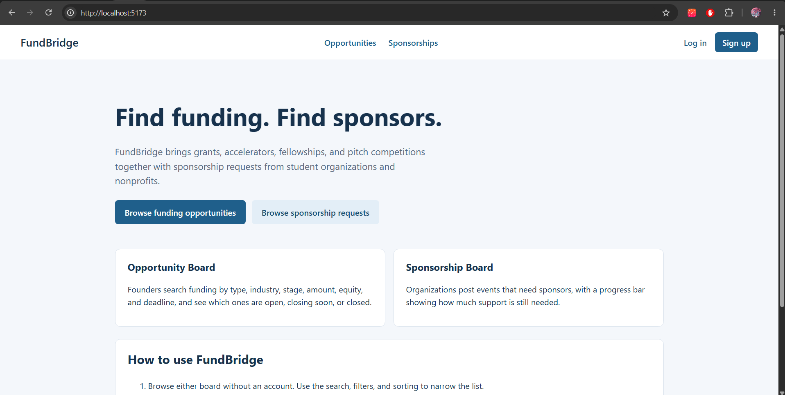
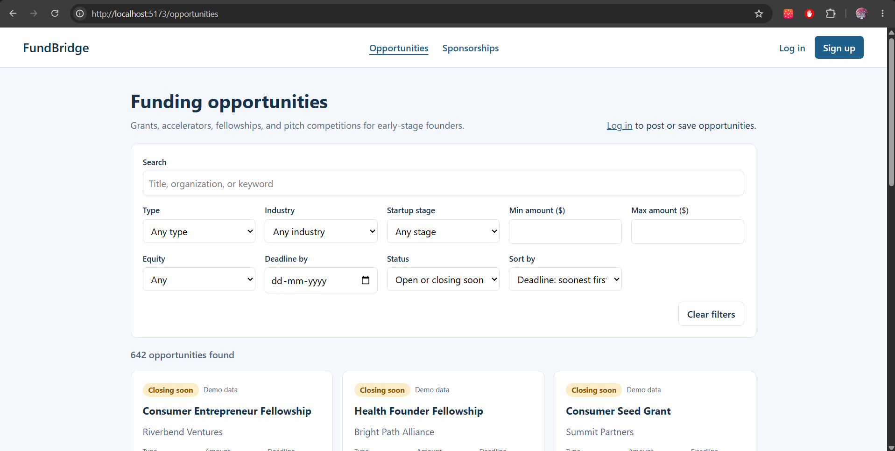

# FundBridge: Funding Opportunities and Sponsorship Requests

**Authors:** Ankita Mandalam and Agilan Balaraman

**Class:** [CS 5610 Web Development](<add class link>)

**Live site:** [Open FundBridge on Render](https://fundbridge-b9s0.onrender.com/)

**Demo video:** <add video link>

**Design document:** <add link>

## Project objective

FundBridge helps startups, student organizations, and nonprofits find funding or request sponsorship. The Opportunity Board collects grants, accelerators, fellowships, and pitch competitions in one searchable place. The Sponsorship Board lets organizations post events that need sponsors and lets companies find events to support.

## Screenshot

## How to use

1. Browse either board without an account, using search, filters, and sorting.
2. Create an account to post opportunities or sponsorship requests. You can edit or delete only your own posts.
3. Save items and track their status from your saved lists.

## Tech stack

React with Hooks (Vite, React Router, PropTypes), Node.js, Express, MongoDB (native driver), and Passport (local strategy) with sessions stored in MongoDB.

## Instructions to build

1. Install Node.js 20 or later.
2. Clone the repository.
3. Backend: `cd backend`, run `npm install`, copy `.env.example` to `.env`, and fill in `MONGO_URL`, `DB_NAME`, `SESSION_SECRET`, and `DEMO_PASSWORD`.
4. Seed the database from `backend`:
   - `npm run seed:opportunities` adds 800 synthetic funding opportunities owned by the `demo_daniel` account.
   - `npm run seed:sponsorships` adds the synthetic sponsorship requests.
5. Frontend: `cd frontend` and run `npm install`.
6. Start the backend with `npm run dev` in `backend`.
7. Start the frontend with `npm run dev` in `frontend`.
8. Open http://localhost:5173.

Production build: run `npm run build` in `frontend`, then `npm start` in `backend`, and open http://localhost:3000.

## License

[MIT](LICENSE)
